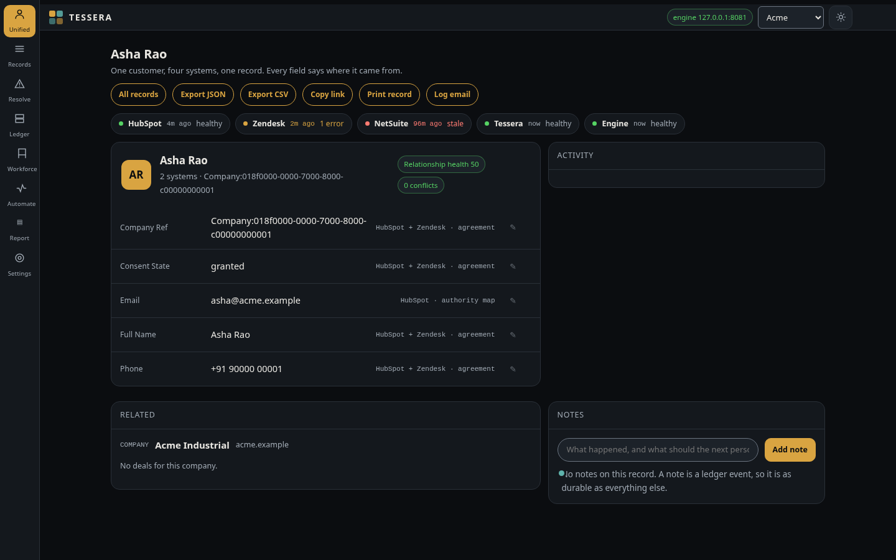
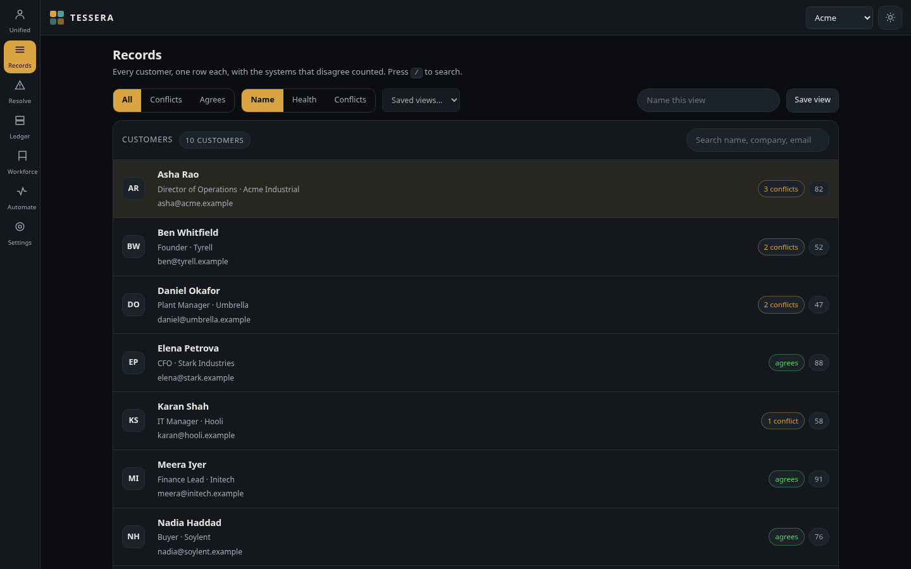
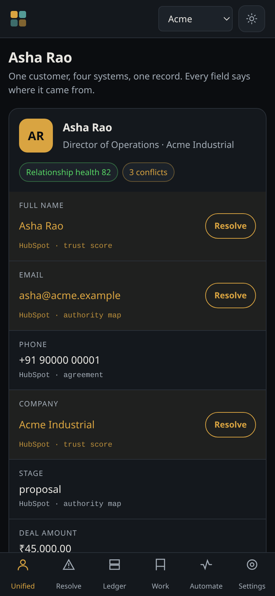
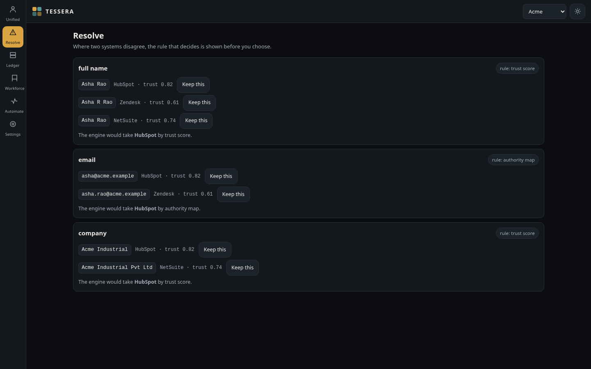
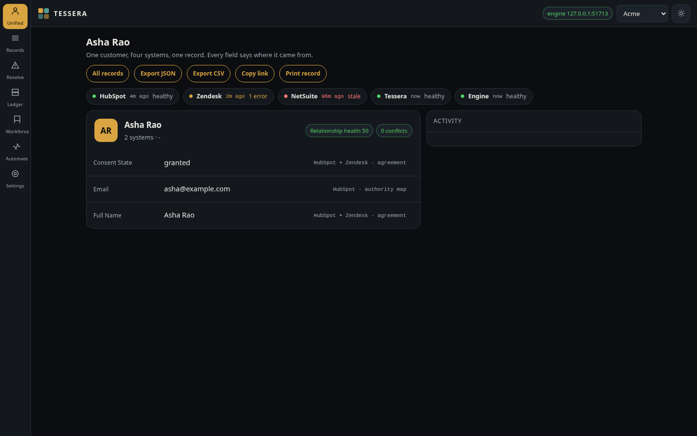

> ## Status: under development
>
> **Not finished, not released.** Published so the work can be inspected, not adopted. Version numbers are build
> numbers; every GitHub release is flagged pre-release. The gate to leave this state is in
> [DEVELOPMENT.md](DEVELOPMENT.md).

<div align="center">


# TESSERA console

**One customer view across every system, with a record you can prove.**

A working, offline, installable console for the [TESSERA reference core](https://github.com/drsamonline/tessera) —
field-level merge, conflict resolution, a hash-chained ledger, seat-based routing and the agent-proposal gate,
all running in your browser with no server and no dependencies.

<a href="https://drsamonline.github.io/tessera-app/"></a>


[**Open the console**](https://drsamonline.github.io/tessera-app/) ·
[The console, live](https://drsamonline.github.io/tessera-app/) ·
[The engine](https://github.com/drsamonline/tessera) ·
[Enhancements](ENHANCEMENTS.md) ·
[Building APK / EXE](BUILDING.md)

</div>

---



## What you are looking at

Four systems hold a slice of the same customer and they disagree. This console merges them **field by field**,
shows **where every value came from**, and records the whole thing in a hash chain you can verify in the page.

| Screen | What it does |
|---|---|
| **Records** | **Contacts, companies and deals** — one switcher, with search, sort and saved views for whichever is on screen. A **New customer** form, and a company sheet listing its people and its deals. `/` searches, filter by conflicts, sort by health, save the view you use every morning, and **import a CSV** with a dry run and a one-press rollback. |
| **Unified** | One record, a **connector strip** above it and **notes** below. Every field can be **edited** — the write goes to the system of record and the ledger records who changed it, from what, to what. Every field names the system it came from and the rule that chose it. Click a value for its write history; export as JSON or CSV; copy a link; **print** it; add a note, or **log an email** — both ledger events, not a separate store. |
| **Resolve** | Both values, both trust scores, the rule the engine would apply, and whether each candidate is the **current** value or a **change**. Choose one, resolve all, or press **Always** to make it a standing rule. Every choice is logged and undoable. |
| **Ledger** | Every event, SHA-256 chained. **Verify chain** recomputes it locally. **Tamper** proves the verification works. An undo is a new event, never a deleted one. |
| **Workforce** | Work goes to a position, not a person. The router shows its term-by-term arithmetic. **Assign**, **assign to me**, or **escalate** with a signed packet — each undoable. |
| **Automate** | A workflow written by an agent is a proposal. The run button is disabled until a person approves it. |
| **Tombstone** | Deleting asks for a reason first. The record stops being served; the reason and the deletion stay in the chain |
| **Related** | On a record: its company (click to see everyone at it) and that company's deals. A deal opens with the same per-field provenance a contact gets |
| **Pipeline** | Deals as columns by stage, with the value in each. A card opens the deal; the arrow moves it and writes the new stage to the system of record |
| **Report** | Contacts, open conflicts, deals and pipeline value; pipeline by stage; which system supplied what share of the data; per-record completeness |
| **Settings** | Theme, density, live storage report, a one-file **workspace backup**, and an **engine connection** — point it at a running TESSERA API and the Records list comes from it. |



<div align="center">

&nbsp;&nbsp;&nbsp;

</div>

## Why it exists

The [engine repository](https://github.com/drsamonline/tessera) is 45 documents and 709 tests of specification and
Python. That is the right artefact for an engineer and the wrong one for anybody deciding whether the idea is
worth an afternoon. This console is the answer to "show me".

Everything on screen is the engine's logic, ported and running client-side:

| Behaviour | Where it comes from |
|---|---|
| Field-level merge with an authority map | `tessera/conflict.py` |
| Trust, then node id, as the tiebreak | `tessera/conflict.py` |
| Weighted routing with a printed breakdown | `tessera/routing.py` |
| SHA-256 chain with sequence and previous hash | `tessera/ledger.py` |
| A proposal cannot run until a human approves | `tessera/automation.py` |

## Run it

```bash
# in place — no build step, no install
open app/index.html

# or over any static server
python3 -m http.server 8000        # then http://localhost:8000/

# or install it
# open /the root in Chrome or Edge → "Install TESSERA" in the address bar
```

Installed, it runs with the network switched off. The service worker caches the shell; the state lives in
IndexedDB with a `localStorage` mirror; the ledger is rebuilt locally if you clear site data. **Settings → Download**
writes the whole workspace to one file, and **Restore** reads it back.

## Properties

| | |
|---|---|
| Dependencies | **none** — no framework, no bundler, no build |
| Payload | `index.html` plus `app.js`, 38.7 KB gzipped against a 48 KB budget, 84 KB raw / 22 KB gzipped, plus a service worker and an icon |
| Contrast | every text pair measured at **≥ 4.5:1** in both themes |
| Touch targets | **44px** minimum; the rail becomes a bottom bar under 860px |
| Keyboard | **⌘K** command palette, **1–7** sections, **/** search, **T** theme, full focus rings |
| Deep links | `#unified/c4` opens that customer; `#deal/<id>` opens a deal; `#records` opens the list; `#command` the palette |
| Print | `@media print` forces paper tokens — see [the sample output](assets/one-pager.pdf) |
| Accessibility | [PERFORMANCE.md](PERFORMANCE.md) | Budgets, the measurement, and CLS 0.291 → 0.021 |
| [A11Y.md](A11Y.md) — eight browser checks, a measured contrast table, and what was not tested |
| Motion | honours `prefers-reduced-motion` |
| Network | none after first load; no analytics, no fonts, no CDN |

## Legal

| | |
|---|---|
| [LICENSE](LICENSE) | PolyForm Noncommercial 1.0.0 — free for noncommercial use |
| [COMMERCIAL.md](COMMERCIAL.md) | The commercial licence, by agreement |
| [PRIVACY.md](PRIVACY.md) | What is stored on your device, what leaves it, and who is responsible |
| [TERMS.md](TERMS.md) | Use, warranty, and what is yours to decide |
| [SECURITY.md](SECURITY.md) | How to report a vulnerability, and the known limits stated up front |
| [REVIEW.md](REVIEW.md) | A code review with findings, evidence and a ship-or-block verdict |
| [DESIGN-REVIEW.md](DESIGN-REVIEW.md) | Three screens judged against the HIG, and what changed |
| [DEBUGGING.md](DEBUGGING.md) | Four bugs, the sequence that found each, and what generalises |

The privacy document is written against the code: `grep -n "fetch(" index.html` lists every request the app can make,
and the document names both of them.

## Android

`android/tessera-1.20.0-debug.apk` — a 17 KB WebView shell, built from source by
`android/scripts/build.sh` with no Gradle and no signing key to create in advance. Sideload it, or read
[android/README.md](android/README.md) for what it does and does not do. **It has never been run on a device** — there
is no emulator in the environment that built it.

## It is a CRM, and it can be the only one

Point it at an engine running `--standalone` and there is no CRM behind it: the native node is the system of record,
**New customer** creates a record there, and every field reads `native · agreement`. Register a connector later and the
same records become a federated view with provenance per field.

```bash
python3 -m tessera.demo --standalone     # in the engine checkout
```

Consent, lawful basis and purpose are required on create and are not defaulted — a record created with an invented
lawful basis is a compliance claim nobody made.

## Reading from a real engine

The console ships with seeded data so it works offline out of the box. Point it at a running engine and it reads live:

```bash
# in the engine repository
python3 -m tessera.api          # prints its URL and token

# then either use Settings → Engine, or open the console with
# ?engine=http://127.0.0.1:8080&token=demo-token
```

The Records list then comes from `/v1/objects/Contact`, each record from `/v1/mesh/view/Contact/{id}`, and every
field arrives with the source the engine chose and the rule it applied — `HubSpot + Zendesk · agreement`,
`HubSpot · authority map`. The console does not re-merge: the engine's answer is the answer.

 The engine's CORS allowlist must include the
console's origin — `docs/46-cors.md` in the engine explains why it is an allowlist and not a wildcard.

## What this is not

- **Not connected to your systems.** The console runs on seeded data. The real connectors exist in the engine and
  have never touched a live tenant — that gap is documented there, not hidden here.
- **Not a backend.** No server, no database, no auth. It demonstrates behaviour so you can judge it before
  reading 45 documents.
- **Not audited.** Hashing is Web Crypto. Do not put real customer data in it.

## Building binaries

An installable PWA covers desktop and Android today. Native wrappers are a packaging step, not a rewrite:

- **Android APK** — a Trusted Web Activity over the hosted URL, or a Capacitor wrap of this folder.
- **Windows / macOS / Linux** — Tauri or Electron around `app/`.
- **Single-file HTML** — already is one; `index.html` opens from disk.

Step-by-step, with the trade-offs: [BUILDING.md](BUILDING.md).

## Enhancements

The exhaustive list of what would make this more useful, more offline and faster — and what to add without
bloating it — is in [ENHANCEMENTS.md](ENHANCEMENTS.md).

## Attribution

| | |
|---|---|
| **Author** | Dr Sohil Momin — [github.com/drsamonline](https://github.com/drsamonline) |
| **Engine** | [drsamonline/tessera](https://github.com/drsamonline/tessera) — specification and reference core |
| **Licence** | [PolyForm Noncommercial 1.0.0](LICENSE) — commercial use requires a licence |
| **Typeface** | system UI fonts only; no webfonts are loaded or redistributed |
| **Icons** | drawn for this project as inline SVG; no icon library is bundled |
| **Hashing** | Web Crypto `SHA-256`, a browser standard, no third-party code |

No third-party code, fonts, images or data are included. The demo record, the activity feed and the seats are
invented for the demonstration and describe no real person or company.

## Sponsor

This is unfunded work. If it saved you an afternoon:

- [ko-fi.com/matneo](https://ko-fi.com/matneo)
- [GitHub Sponsors](https://github.com/sponsors/drsamonline)

Commercial use, white-labelling or a support agreement: open an issue and say what you need.

---

<div align="center">
<sub>PolyForm Noncommercial 1.0.0 · built by Dr Sohil Momin · <a href="https://drsamonline.github.io/tessera-app/">open the console</a></sub>
</div>
